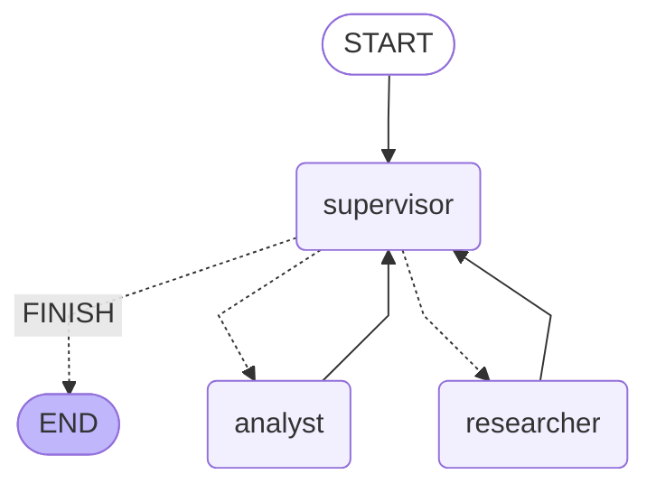

# Pre-entrega 6: Orquestador multi-agente

Prototipo de orquestador jerárquico con LangGraph: un **supervisor** enruta entre un agente de **investigación** y uno de **análisis**, y cierra cuando la tarea está completa.

## Topología

Elegí topología jerárquica (supervisor → especialistas → supervisor) porque un solo router decide el flujo, los especialistas no se hablan entre sí y el contexto de ruteo queda centralizado.



## Conflictos entre agentes

Solo el supervisor escribe `next`. Cada especialista appendea un mensaje con `name` propio; no se pisan. Si el orden es incorrecto, la rúbrica del supervisor corrige; el tope `steps >= 4` fuerza `FINISH` y evita el loop infinito.

## Estructura

- `state.py` — `OrchestratorState` (`MessagesState` + `next` + `steps`)
- `agents/researcher.py` — tool `search_corpus` (corpus local simulado)
- `agents/analyst.py` — tool `percent_change`
- `graph.py` — supervisor + grafo
- `main.py` — demo del flujo de delegación

## Cómo correr

```bash
python -m venv .venv
source .venv/bin/activate
pip install -r requirements.txt
# crear .env con OPENAI_API_KEY=...
PYTHONPATH=. python main.py
```

Consulta de demo: ventas Acme 2023/2024 → cambio porcentual. Trazado esperado: `supervisor → researcher → supervisor → analyst → supervisor → FINISH`.
